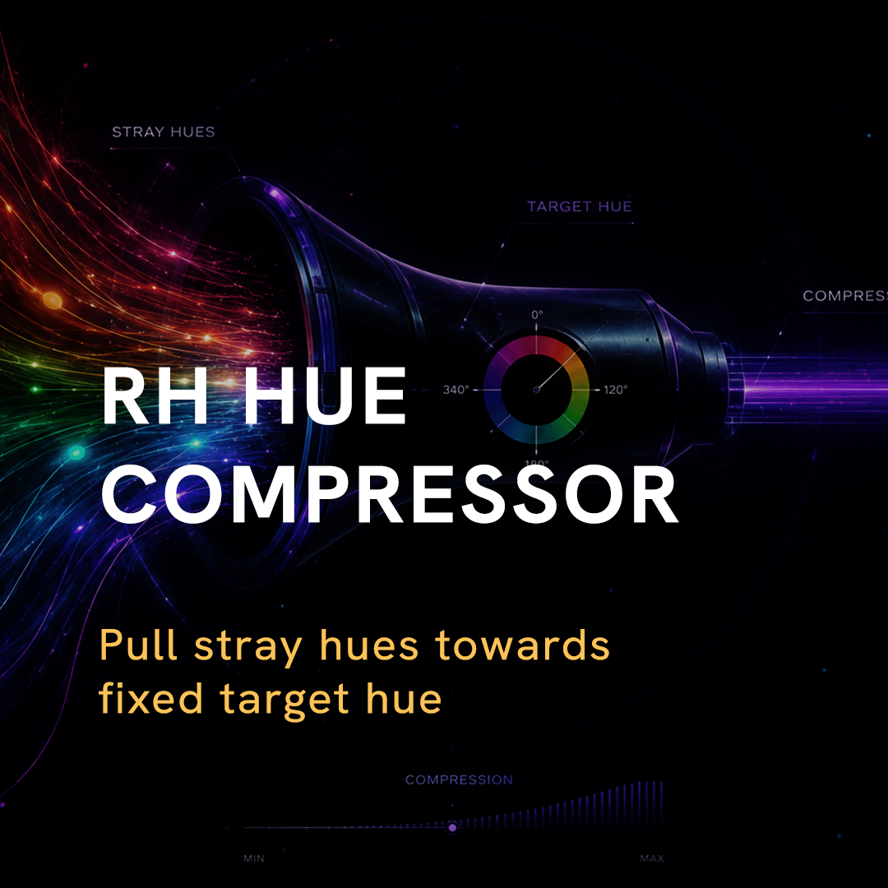
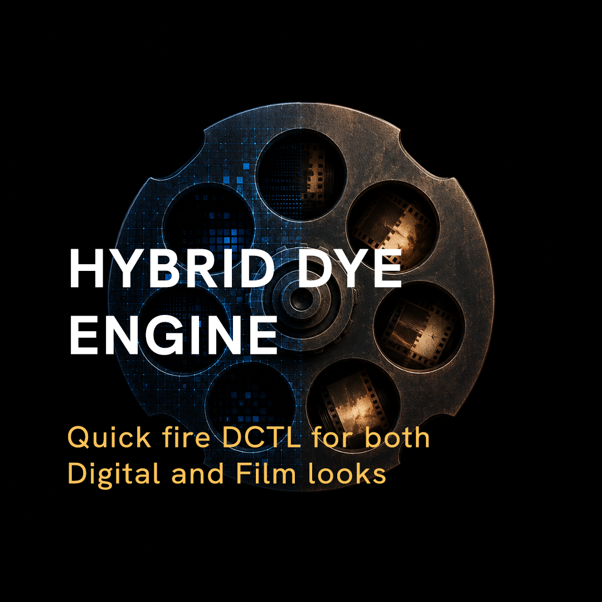
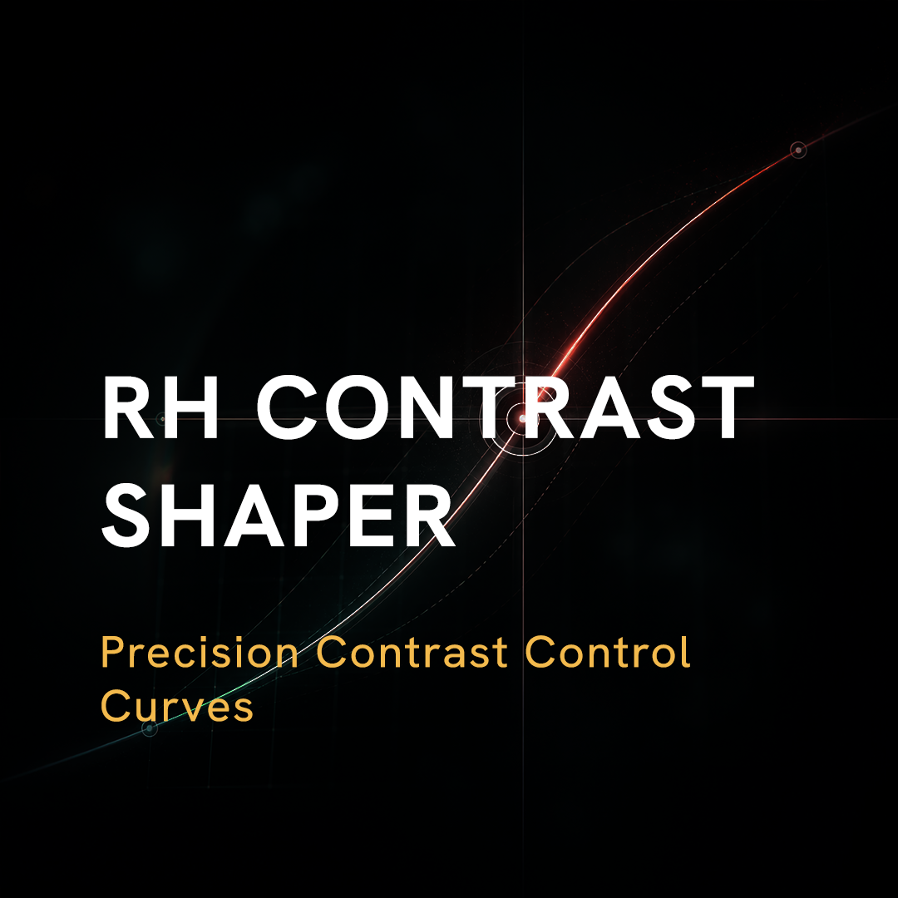
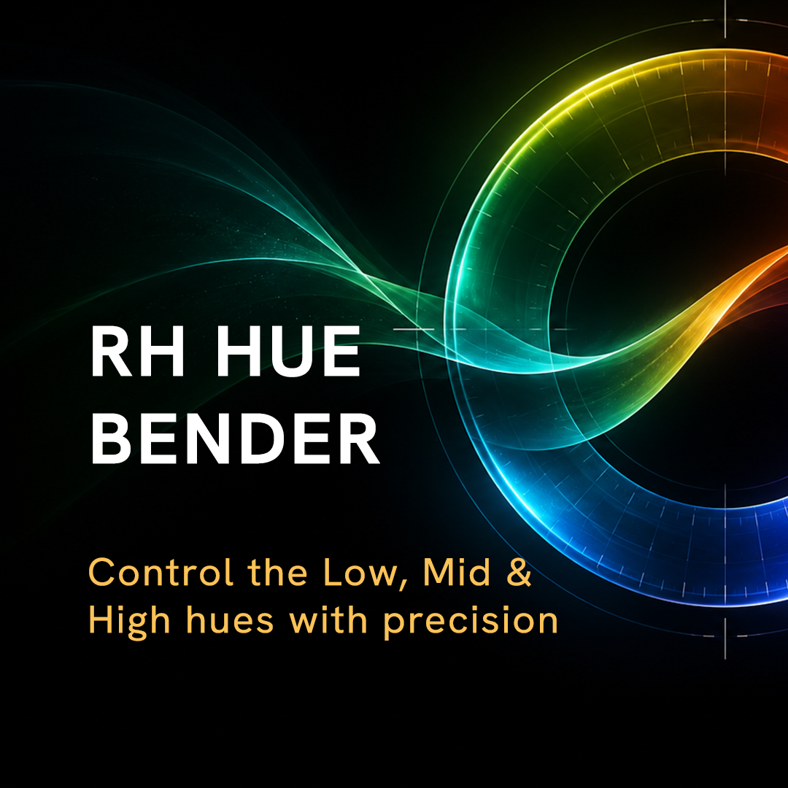
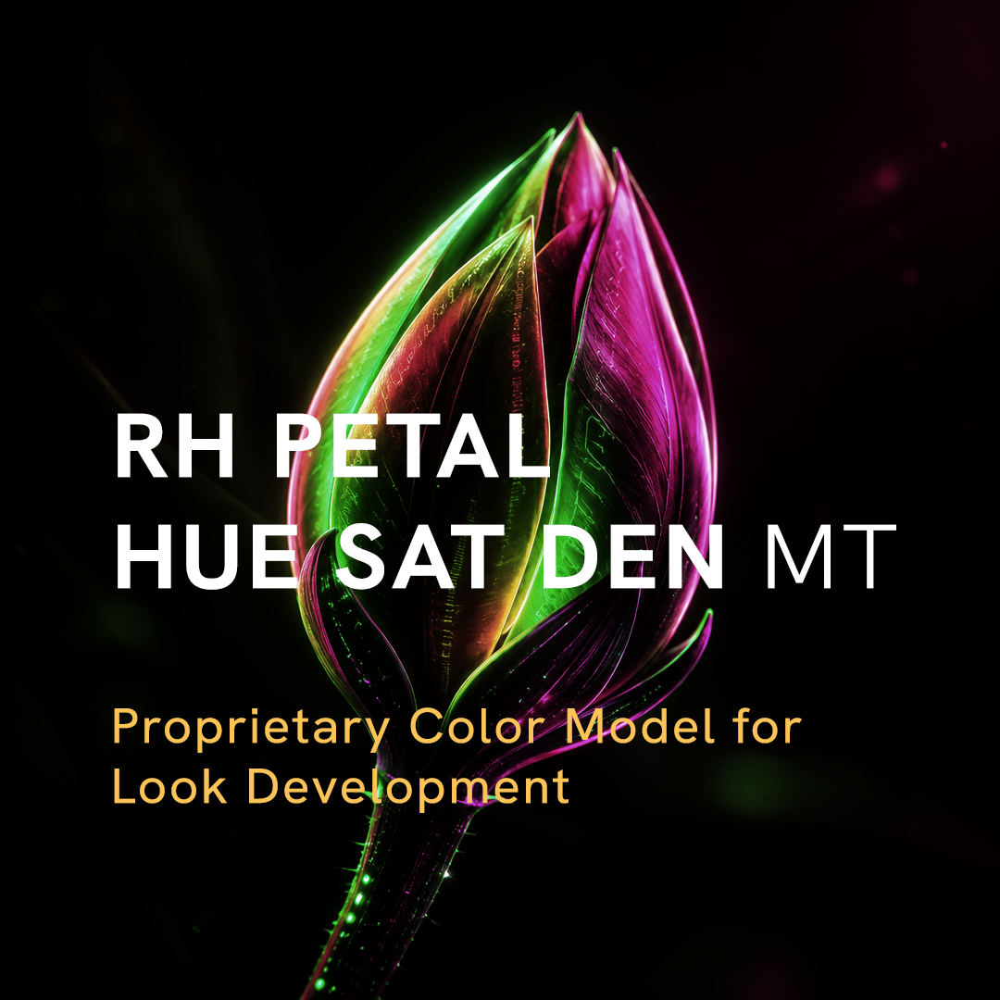
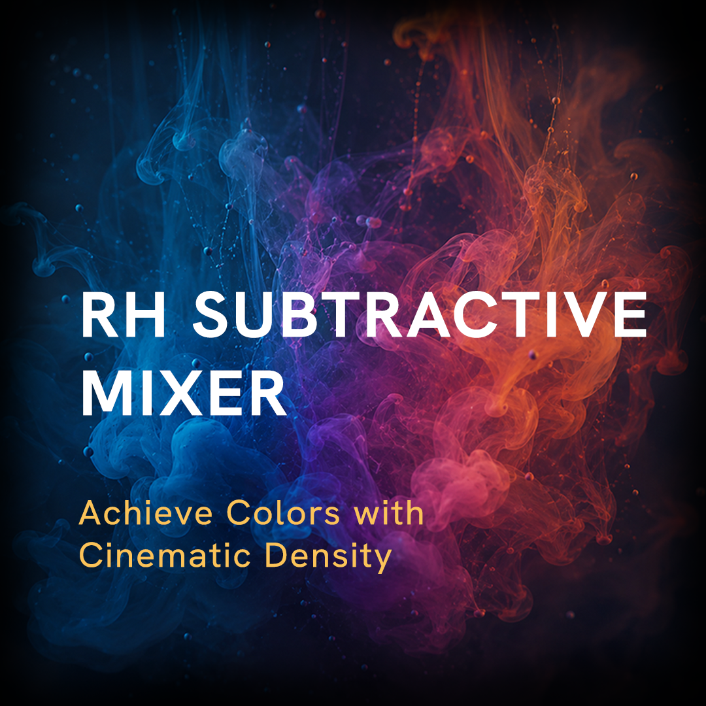
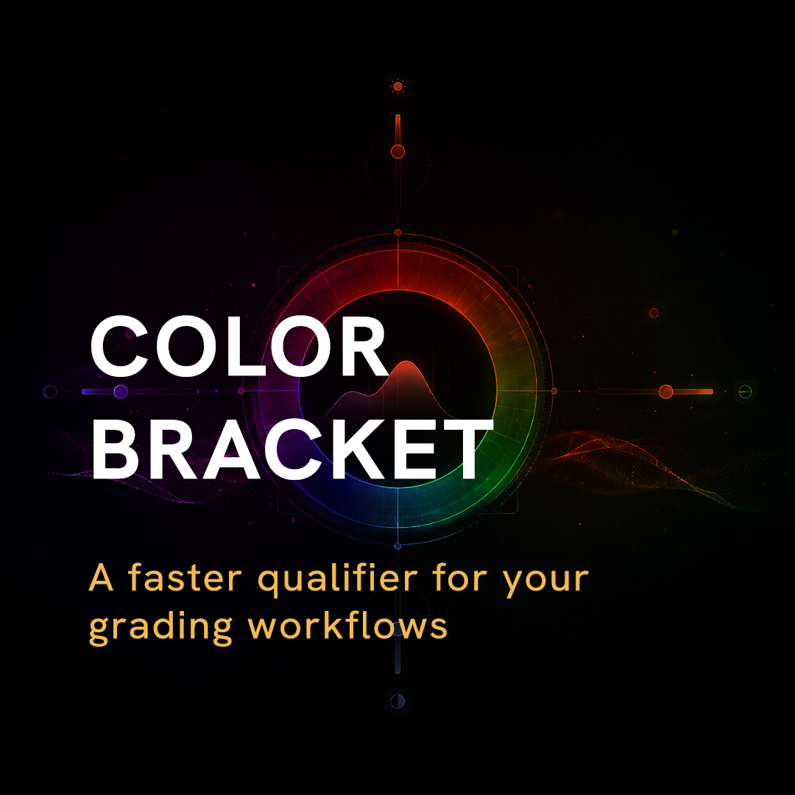
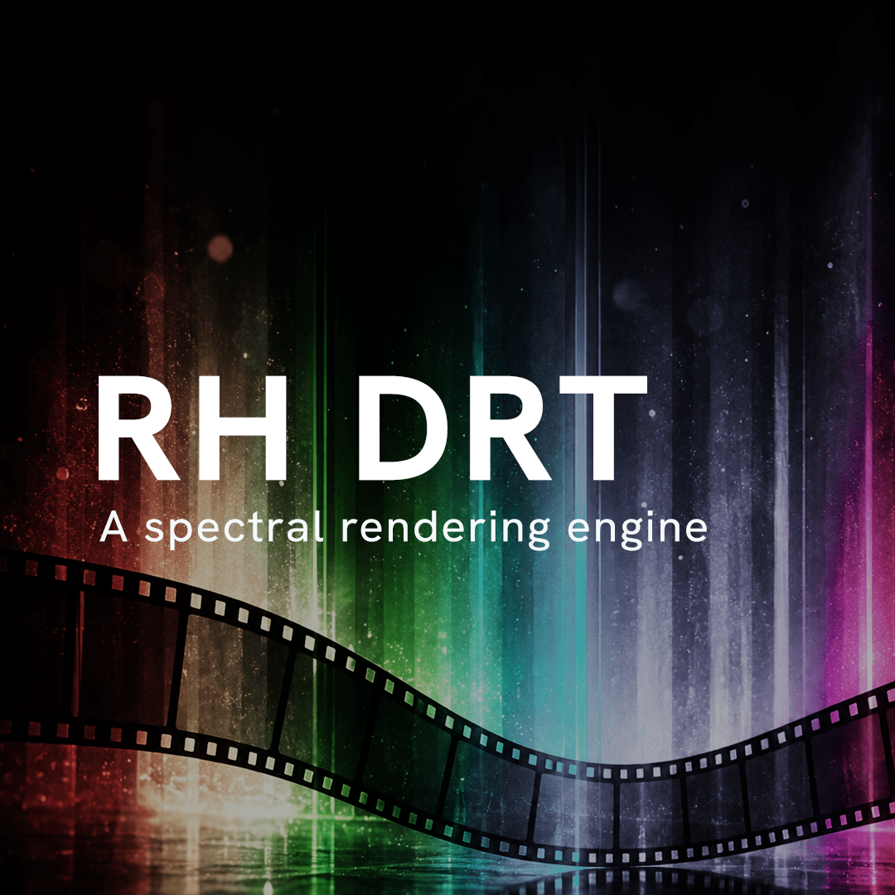
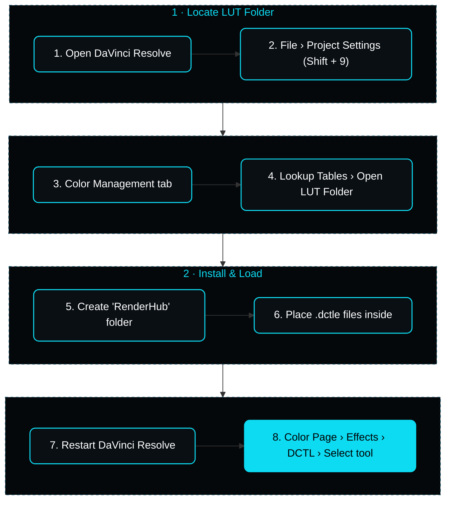
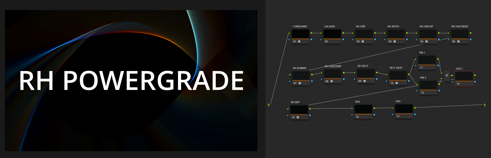

<p align="center">
  <a href="https://renderhub.in">
    
  </a>
</p>

# RenderHub DCTLs - DaVinci Resolve Studio Color Grading Tools

> 🌟🌟🌟 **Season Greetings:** December Release will include **ALL** of my DCTLs including **RH DRT**, **RH Petal Hue Sat Den MT**, and **RH Hue Bender**. 🌟🌟🌟

---

## 📥 Downloads & Updates

<a href="https://github.com/Senthil360/RenderHub-DCTLs/releases/latest">
  
</a>

[🏷️ **View Older Versions**](https://github.com/Senthil360/RenderHub-DCTLs/tags)

---

## 🌟 Welcome
 **RenderHub Tools** features high-precision DCTLs and plugins designed to elevate your DaVinci Resolve workflow.

### 🧩 DCTL Suite Overview
*Click any tool below to view full details on [renderhub.in](https://renderhub.in).*

<table>
  <tr>
    <td align="center" width="20%">
      <a href="https://renderhub.in/products/rh-chroma-gate">
        
      </a><br />
      <sub><strong>RH Chroma Gate</strong></sub>
    </td>
    <td align="center" width="20%">
      <a href="https://renderhub.in/products/rh-end-tones-sculptor">
        
      </a><br />
      <sub><strong>RH End Tones Sculptor</strong></sub>
    </td>
    <td align="center" width="20%">
      <a href="https://renderhub.in/products/rh-hue-compressor">
        
      </a><br />
      <sub><strong>RH Hue Compressor</strong></sub>
    </td>
    <td align="center" width="20%">
      <a href="https://renderhub.in/products/rh-hybrid-dye-engine">
        
      </a><br />
      <sub><strong>RH Hybrid Dye Engine</strong></sub>
    </td>
    <td align="center" width="20%">
      <a href="https://renderhub.in/products/rh-contrast-shaper">
        
      </a><br />
      <sub><strong>RH Contrast Shaper</strong></sub>
    </td>
  </tr>
  <tr>
    <td align="center" width="20%">
      <a href="https://renderhub.in/products/rh-hue-bender">
        
      </a><br />
      <sub><strong>RH Hue Bender</strong><br /><em>(Coming Dec 2026)</em></sub>
    </td>
    <td align="center" width="20%">
      <a href="https://renderhub.in/products/rh-petal-huesatden-mt">
        
      </a><br />
      <sub><strong>RH Petal Hue Sat Den MT</strong><br /><em>(Coming Dec 2026)</em></sub>
    </td>
    <td align="center" width="20%">
      <a href="https://renderhub.in/products/rh-subtractive-mixer">
        
      </a><br />
      <sub><strong>RH Subtractive Mixer</strong></sub>
    </td>
    <td align="center" width="20%">
      <a href="https://renderhub.in/products/rh-color-bracket">
        
      </a><br />
      <sub><strong>RH Color Bracket</strong></sub>
    </td>
    <td align="center" width="20%">
      <a href="https://renderhub.in/rh-drt">
        
      </a><br />
      <sub><strong>RH DRT</strong><br /><em>(Coming Dec 2026)</em></sub>
    </td>
  </tr>
</table>

<details>
<summary><strong>📖 Tool Breakdown — What Each DCTL Does</strong> <em>(Click to expand)</em></summary>

- **[RH Chroma Gate](https://renderhub.in/products/rh-chroma-gate)** — *Tonal Zone Aware Saturation Shaping.* Separates saturation control across 6 hue vectors (RGBCMY) and 3 custom luminance zones (Low, Mid, High) with adjustable pivot softness and a false-colour zone mask preview.
- **[RH End Tones Sculptor](https://renderhub.in/products/rh-end-tones-sculptor)** — *Finesse Highlights & Shadows.* Independent RGB balance, saturation, and hue rotation for shadows and highlights without touching midtones, complete with zone masks and a live tone-curve overlay.
- **[RH Hue Compressor](https://renderhub.in/products/rh-hue-compressor)** — *Pure Hue or a Magical hue number, you choose.* Compresses stray hues proportionally toward custom target angles in a polar chromaticity model with per-vector center offset and range controls.
- **[RH Hybrid Dye Engine](https://renderhub.in/products/rh-hybrid-dye-engine)** — *Quick fire DCTL for Digital and Film looks alike.* Density-dependent crossfade fusing spectral film dye simulation (multi-layer emulsion, DIR couplers, halation, silver retention) with a clean additive digital tone curve.
- **[RH Contrast Shaper](https://renderhub.in/products/rh-contrast-shaper)** *(formerly RH MidControl)* — *Photometric Exposure & C2 Pivoted Contrast Engine.* Adjust photometric DI exposure in stops, pivot Linear or C2 S-Curve contrast around any user-definable Mid Point, and sculpt toe/shoulder roll-off with Luma Only mode.
- **[RH Hue Bender](https://renderhub.in/products/rh-hue-bender)** *(Coming Dec 2026)* — *Control the Low, Mid & High hues with precision.* Directional hue sculpting across 6 hue vectors and 3 tonal zones in customized HRO space (Fixed & Native models) with zone softness and a built-in palette visualizer.
- **[RH Petal Hue Sat Den MT](https://renderhub.in/products/rh-petal-huesatden-mt)** *(Coming Dec 2026)* — *Proprietary Color Model for accurate Look Development.* Six-vector hue, saturation, and density sculpting built on the Petal Color Model with Mock Theta Basis Weights for independent vector width and asymmetry (Deviation).
- **[RH Subtractive Mixer](https://renderhub.in/products/rh-subtractive-mixer)** — *Achieve Colors with Cinematic Density.* True subtractive color mixing in physical dye density space with 6 pure-hue shifts, Subtractive Saturation, Lock Luminance, and Shift Sensitivity.
- **[RH Color Bracket](https://renderhub.in/products/rh-color-bracket)** — *Fastest way to qualify and modify colors.* Surgical geometric hue bracketing without noisy qualifiers, offering asymmetric width, outer softness, density, saturation, and uniform hue forcing.
- **[RH DRT](https://renderhub.in/rh-drt)** *(Coming Dec 2026)* — *Photochemical pipeline inside a DCTL.* Display Rendering Transform (DRT) delivering filmic density and photochemical color rendering for DaVinci Resolve Studio.

</details>

All tools assume:
- Scene-referred input in **DaVinci Wide Gamut / Intermediate (DWG/DI) or similar**
- Proper color management upstream

These are not presets, LUT packs, or one-click film looks.


### 🤝 Join the Community
<p>
  <a href="https://renderhub.in">
    
  </a>
  <a href="https://www.youtube.com/c/SenthilManikandan">
    
  </a>
  <a href="https://discord.gg/AfhBtwaHGS">
    
  </a>
  <a href="https://www.instagram.com/colorwizard_30">
    
  </a>
</p>

### ☕ Buy Me a Coffee
  <a href="https://renderhub.in/donate">
    
  </a>
  
---

## 💿 Installation

*Note: Native DCTL support requires **DaVinci Resolve Studio** (the paid version).*
*You can try using the installers in the 'installer' folder. If that does not work, follow the instructions below.*

### How to install DCTLs in DaVinci Resolve Studio



### Manual Installation Paths
If you prefer to copy the files manually, the default directories are:

**macOS:**
```text
/Library/Application Support/Blackmagic Design/DaVinci Resolve/LUT/
```

**Windows:**
```text
C:\ProgramData\Blackmagic Design\DaVinci Resolve\Support\LUT\
```

### 🎬 Video Guide on Installation
<a href="https://youtu.be/gxFVYyTGwoM">
  
</a>

---

## 🎛️ RH PowerGrade

RenderHub DCTLs can be used in any user-preferred manner and included at any stage in your color grading pipeline — with the exception of **RH DRT**, which is a Display Rendering Transform taking your image from a working color space to a display space.

Use the starter node tree below as a foundation for grading with RenderHub DCTLs, and feel free to download and modify it as you see fit.

<p align="center">
  <a href="https://renderhub.in/docs/powergrades">
    
  </a>
</p>

- **Download PowerGrade Files:** Keep both [`RH_PowerGrade.drx`](powergrades/RH_PowerGrade.drx) and [`RH_PowerGrade.dpx`](powergrades/RH_PowerGrade.dpx) together in the same folder, then right-click inside DaVinci Resolve's **Gallery › PowerGrades** bin and choose **Import...**
- **Workflow Guide:** [PowerGrades Documentation on renderhub.in](https://renderhub.in/docs/powergrades)

---

## 📖 Documentation

Full usage documentation, control references, and workflow guidance are available on the [**RenderHub Website**](https://renderhub.in/docs).

---

## 📈 Development Status

This repository is under active development. Tools may evolve, controls may change, and behaviour may be refined. There is no fixed roadmap or timeline. Feedback is welcome, but implementation decisions remain scoped intentionally. I wish to keep these tools free forever — if you find them useful, please [consider supporting development with a donation](https://renderhub.in/donate). It greatly helps fund ongoing development.

---

## 📄 License

Please see the [LICENSE](LICENSE) file for usage terms.
