<p align="center">
  <a href="https://renderhub.in">
    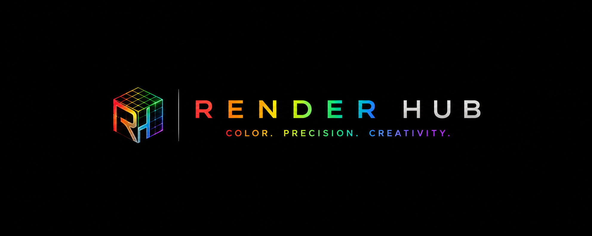
  </a>
</p>

> 🌟🌟🌟 **Season Greetings:** December Release will include **ALL** of my DCTLs including **RH DRT**, **RH Petal Hue Sat Den MT**, and **RH Hue Bender**. 🌟🌟🌟

---

## 📥 Downloads & Updates

<a href="https://github.com/Senthil360/RenderHub-DCTLs/releases/">
  
</a>

[🏷️ **View Older Versions**](https://github.com/Senthil360/RenderHub-DCTLs/tags)

---

## 🌟 Welcome
 **RenderHub Tools** features high-precision DCTLs and plugins designed to elevate your DaVinci Resolve workflow.

### 🧩 DCTL Suite Overview
*Click any tool below to view full details on [renderhub.in](https://renderhub.in).*

<table>
  <tr>
    <td align="center" width="20%">
      <a href="https://renderhub.in/products/rh-end-tones-sculptor">
        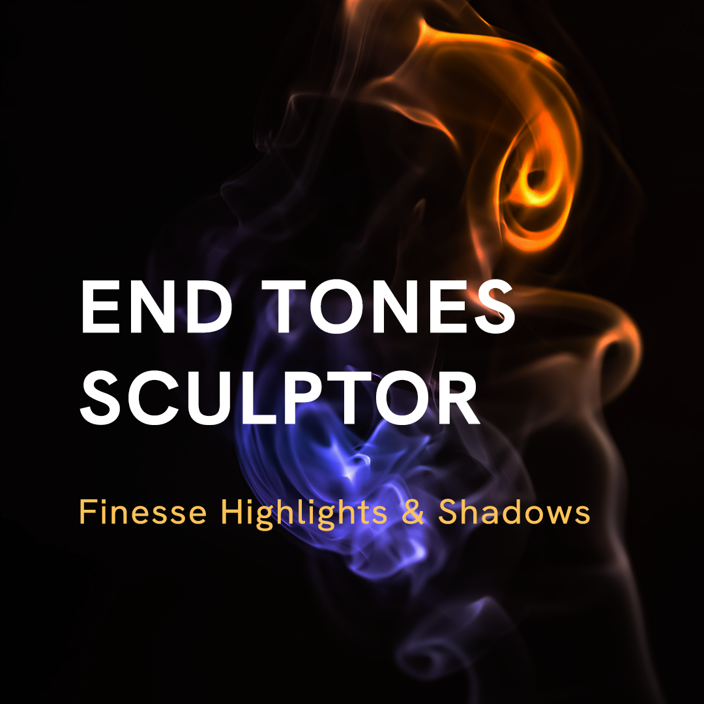
      </a><br />
      <sub><strong>RH End Tones Sculptor</strong></sub>
    </td>
    <td align="center" width="20%">
      <a href="https://renderhub.in/products/rh-hue-compressor">
        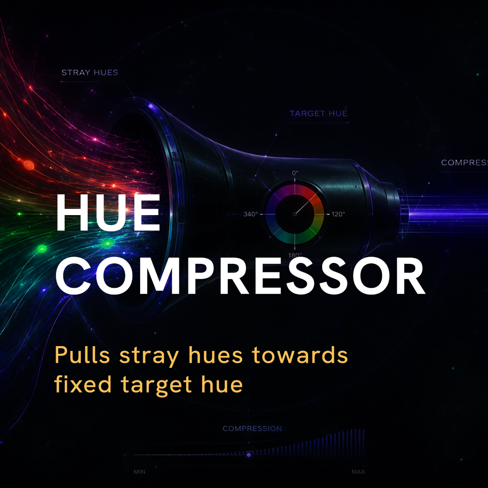
      </a><br />
      <sub><strong>RH Hue Compressor</strong></sub>
    </td>
    <td align="center" width="20%">
      <a href="https://renderhub.in/products/rh-chroma-gate">
        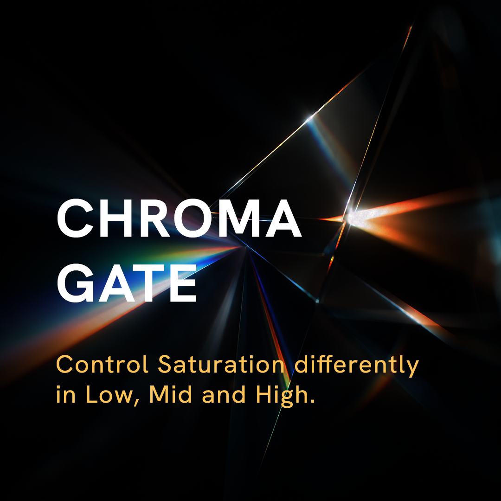
      </a><br />
      <sub><strong>RH Chroma Gate</strong></sub>
    </td>
    <td align="center" width="20%">
      <a href="https://renderhub.in/products/rh-subtractive-mixer">
        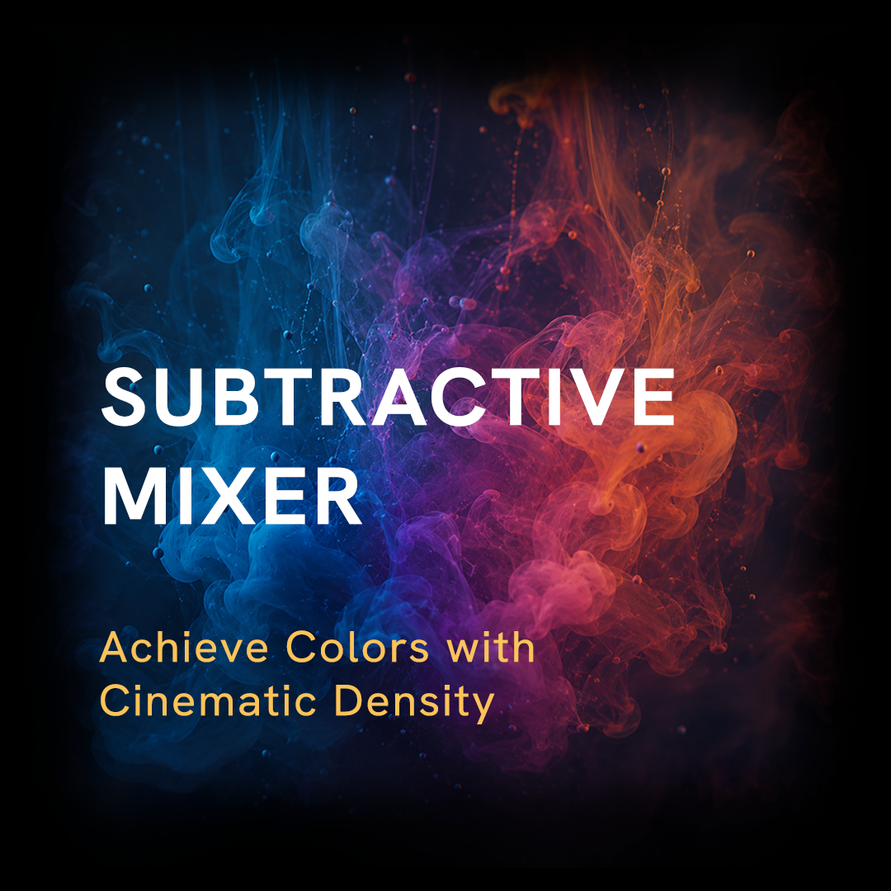
      </a><br />
      <sub><strong>RH Subtractive Mixer</strong></sub>
    </td>
    <td align="center" width="20%">
      <a href="https://renderhub.in/products/rh-hybrid-dye-engine">
        
      </a><br />
      <sub><strong>RH Hybrid Dye Engine</strong></sub>
    </td>
  </tr>
  <tr>
    <td align="center" width="20%">
      <a href="https://renderhub.in/products/rh-filmic-colors">
        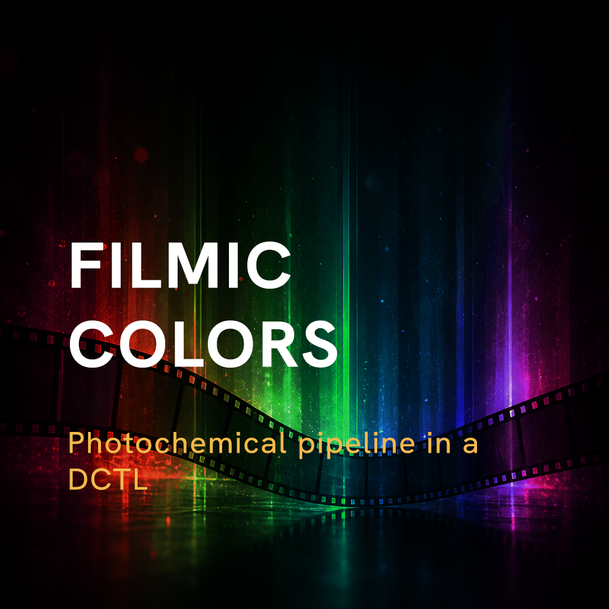
      </a><br />
      <sub><strong>RH Filmic Colors</strong></sub>
    </td>
    <td align="center" width="20%">
      <a href="https://renderhub.in/products/rh-midcontrol-pro">
        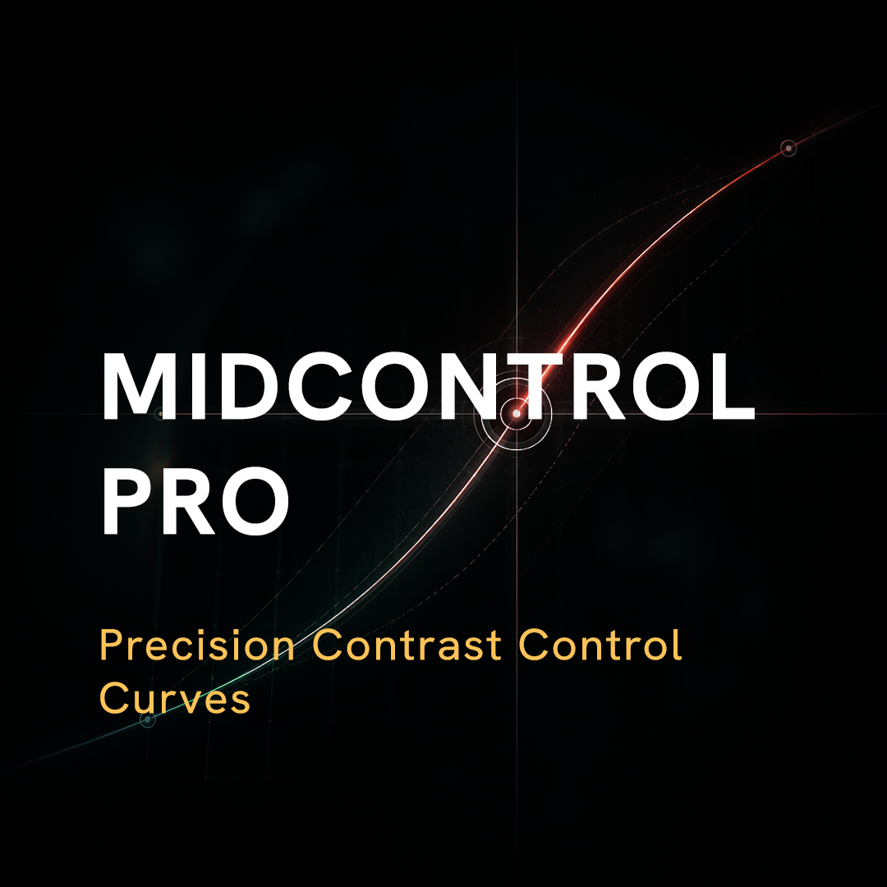
      </a><br />
      <sub><strong>RH MidControl</strong></sub>
    </td>
    <td align="center" width="20%">
      <a href="https://renderhub.in/products/rh-drt">
        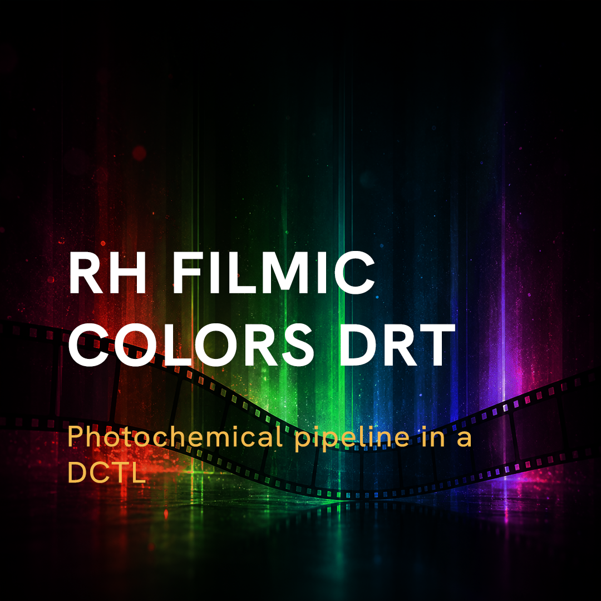
      </a><br />
      <sub><strong>RH DRT</strong><br /><em>(Coming Dec 2026)</em></sub>
    </td>
    <td align="center" width="20%">
      <a href="https://renderhub.in/products/rh-petal-hue-sat-den-mt">
        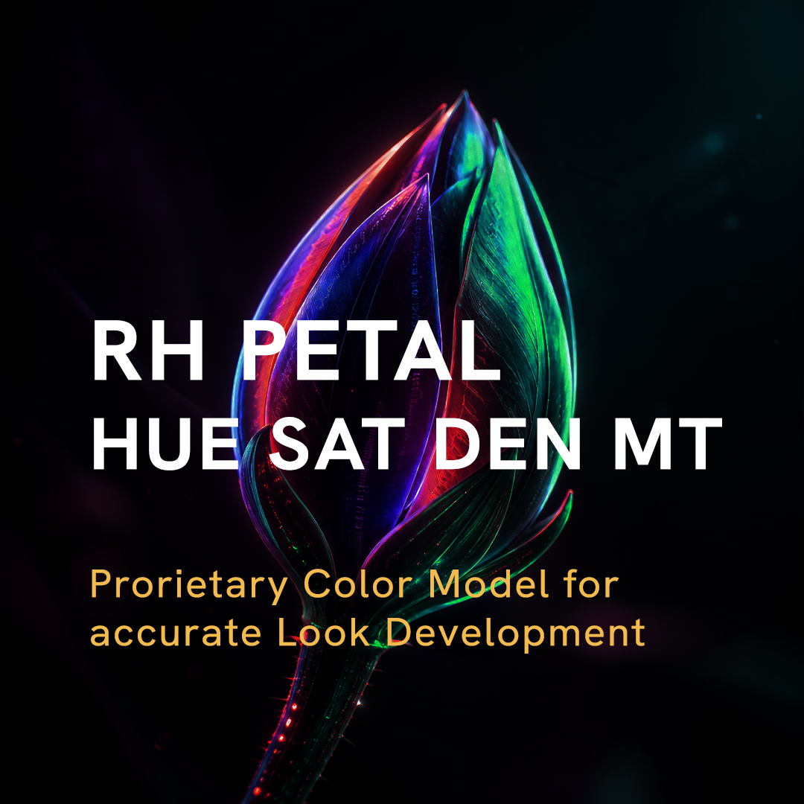
      </a><br />
      <sub><strong>RH Petal Hue Sat Den MT</strong><br /><em>(Coming Dec 2026)</em></sub>
    </td>
    <td align="center" width="20%">
      <a href="https://renderhub.in/shop">
        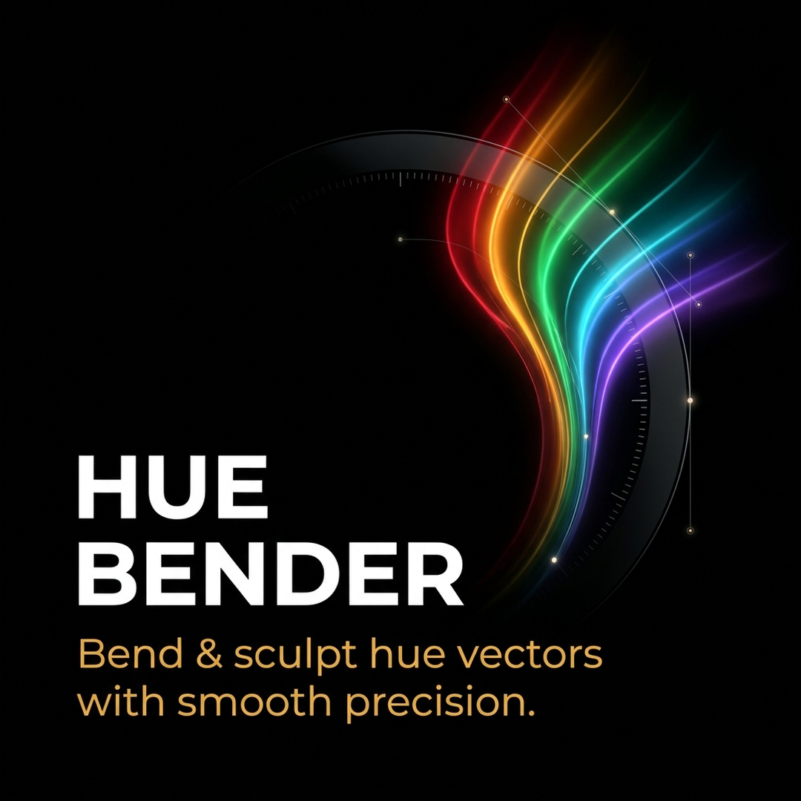
      </a><br />
      <sub><strong>RH Hue Bender</strong><br /><em>(Coming Dec 2026)</em></sub>
    </td>
  </tr>
</table>

All tools assume:
- Scene-referred input in **DaVinci Wide Gamut / Intermediate (DWG/DI) or similar**
- Proper color management upstream

These are not presets, LUT packs, or one-click film looks.


### 🤝 Join the Community
<p>
  <a href="https://renderhub.in">
    
  </a>
  <a href="https://www.youtube.com/c/SenthilManikandan">
    
  </a>
  <a href="https://discord.gg/QZKHgUba8">
    
  </a>
  <a href="https://www.instagram.com/colorwizard_30">
    
  </a>
</p>

### ☕ Buy Me a Coffee
  <a href="https://renderhub.in/donate">
    
  </a>
  
---

## 💿 Installation

*Note: Native DCTL support requires **DaVinci Resolve Studio** (the paid version).*
*You can try using the installers in the 'installer' folder. If that does not work, follow the instructions below.*

### How to install DCTLs in DaVinci Resolve Studio

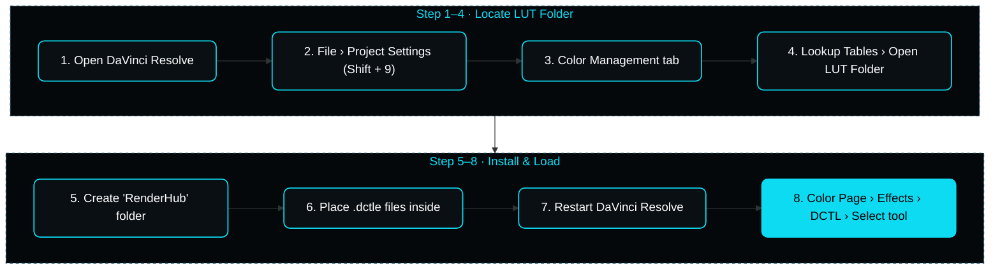

### Manual Installation Paths
If you prefer to copy the files manually, the default directories are:

**macOS:**
```text
/Library/Application Support/Blackmagic Design/DaVinci Resolve/LUT/
```

**Windows:**
```text
C:\ProgramData\Blackmagic Design\DaVinci Resolve\Support\LUT\
```

### 🎬 Video Guide on Installation
<a href="https://youtu.be/gxFVYyTGwoM">
  
</a>

---

## 📖 Documentation

Full usage documentation, control references, and workflow guidance are available on the [**RenderHub Website**](https://renderhub.in/docs).

---

## 📈 Development Status

This repository is under active development. Tools may evolve, controls may change, and behaviour may be refined. There is no fixed roadmap or timeline. Feedback is welcome, but implementation decisions remain scoped intentionally. I wish to keep these tools free forever, if you find these tools useful consider purchasing them. It will greatly help with development.

---

## 📄 License

Please see the [LICENSE](LICENSE) file for usage terms.
